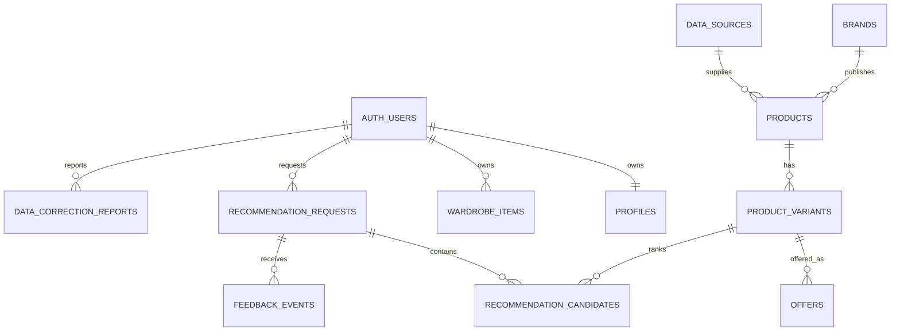

# Database Design & SQL Contract v0

## 문서 상태

| 항목 | 내용 |
|---|---|
| 상태 | 설계 기준선 v0 · Issue #5 초기 migration/RLS 스파이크 진행 중 |
| 적용 시점 | 개발용 기반을 조기 검증하고, 9주차에 인증·삭제·복구·운영 준비까지 완성 |
| 기준 저장소 | PostgreSQL on Supabase |
| 범위 | 프로필, 옷장, 상품, 가격·재고, 추천 요청·결과, 피드백, 오류 신고 |
| 제외 | 결제·주문 ERP, 무단 수집 데이터, 운영 사용자 원본, 검색 전용 별도 엔진 |

이 문서는 FITWISE의 데이터가 어떻게 저장·조회·수정·삭제되는지와 SQL 작성 규칙을 고정한다. Issue #5에서 로컬/CI PostgreSQL migration, 소유자 RLS, 합성 카탈로그와 수집 권한 게이트를 먼저 구현한다. SQL을 운영 환경에 적용하지 않으며, 실제 공급원 권리와 연결 자격 증명은 별도 승인을 기다린다. 이 초기 스파이크는 인증·계정 삭제·복구·성능 운영을 포함하는 9주차 완료를 대체하지 않는다.

## 설계 원칙

1. PostgreSQL을 제품 데이터의 최종 기준으로 사용한다. 앱 캐시와 검색 색인은 언제든 다시 만들 수 있는 복제본이다.
2. 모바일 앱에는 DB 접속 문자열이나 Supabase `service_role` 키를 넣지 않는다.
3. 사용자 소유 데이터는 `owner_id`로 분리하고 RLS를 활성화한다.
4. 검색·권한·정렬에 쓰는 값은 JSON이 아니라 타입이 있는 컬럼으로 저장한다.
5. 금액은 부동소수점 대신 최소 통화 단위의 정수(`price_minor`)와 `currency_code`로 저장한다.
6. 모든 시각은 `timestamptz`로 저장하고 UTC를 기준으로 해석한다.
7. 실제 상품은 출처, 이용 범위, 관찰 시각과 만료 상태가 없으면 추천 후보로 사용하지 않는다.
8. 변경 SQL은 매개변수화하고, 소유자 조건과 영향 행 수를 확인한다.
9. 삭제는 DB 행만 지우는 작업이 아니다. Storage 객체, 캐시, 검색 색인과 파생 데이터를 같은 삭제 작업으로 추적한다.
10. 스키마 변경은 버전 관리되는 migration으로만 수행한다.

## 데이터 경계와 관계



권장 논리 스키마는 다음과 같다.

| 스키마 | 책임 | 공개 여부 |
|---|---|---|
| `profile` | 프로필, 동의, 옷장 | 사용자 소유 행만 API 노출 |
| `catalog` | 브랜드, 상품, 옵션, 가격·재고, 출처 | 승인된 읽기 모델만 노출 |
| `recommendation` | 요청, 후보, 점수, 근거, 피드백 | 사용자 소유 행만 노출 |
| `audit` | 오류 신고, 삭제 작업, 보안 사건 | 서버·운영자 전용 |

`auth.users`는 Supabase Auth가 관리한다. 앱 프로필은 동일한 UUID를 외래키로 참조하되 인증 테이블에 신체정보나 앱 설정을 추가하지 않는다.

## 핵심 데이터 사전

| 테이블 | 주요 컬럼 | 소유·출처 | 보존·삭제 |
|---|---|---|---|
| `profile.profiles` | `id`, 선택 신체·핏 값, `consent_version` | `id = auth.users.id` | 계정 삭제 요청 시 제거 |
| `profile.wardrobe_items` | `id`, `owner_id`, 카테고리·색상·핏, 이미지 경로 | 사용자 | 먼저 삭제 표시 후 Storage 정리와 함께 제거 |
| `catalog.data_sources` | 제공처, 이용 범위, 갱신 주기 | 서버 | 계약·감사 기간에 따름 |
| `catalog.products` | 출처 상품 ID, 브랜드, 이름, 카테고리, 최신성 | 제공처 | 제공 중단 시 비활성화, 권리 소멸 시 제거 |
| `catalog.product_variants` | 상품, 색상, 사이즈, 실측 | 제공처 | 상위 상품 정책을 따름 |
| `catalog.offers` | 가격, 통화, 재고 상태, 관찰·만료 시각 | 판매처 | 최신 스냅샷과 제한된 이력 |
| `recommendation.requests` | 사용자 조건, 규칙 버전, idempotency key | 사용자 | 제품 정책에 정한 기간 후 삭제·익명화 |
| `recommendation.candidates` | 후보, 구성 점수, 근거, 순위 | 요청 | 요청과 함께 삭제 |
| `recommendation.feedback_events` | 저장·제외·선택·핏 평가 | 사용자 | 철회·계정 삭제 정책 적용 |
| `audit.data_correction_reports` | 오류 유형, 대상 레코드, 처리 상태 | 신고자·운영 | 검색 원문·신체정보를 복제하지 않음 |

상세 보존 기간은 개인정보 영향 평가와 베타 약관 검토 후 확정한다. 확정 전에는 “무기한 보관”을 기본값으로 사용하지 않는다.

## DDL 초안

아래 SQL은 구조와 제약 조건을 설명하는 초안이다. 실제 migration에는 테이블별 주석, 권한 회수, RLS, down/복구 절차와 테스트를 함께 넣는다.

```sql
create schema if not exists profile;
create schema if not exists catalog;
create schema if not exists recommendation;
create schema if not exists audit;

create table profile.profiles (
    id uuid primary key references auth.users (id) on delete cascade,
    height_mm integer check (height_mm between 1000 and 2500),
    consent_version text,
    consented_at timestamptz,
    created_at timestamptz not null default now(),
    updated_at timestamptz not null default now()
);

create table profile.wardrobe_items (
    id uuid primary key default gen_random_uuid(),
    owner_id uuid not null references auth.users (id) on delete cascade,
    category_code text not null,
    color_code text,
    fit_code text,
    image_object_path text,
    version integer not null default 1 check (version > 0),
    created_at timestamptz not null default now(),
    updated_at timestamptz not null default now(),
    deleted_at timestamptz
);

create table catalog.data_sources (
    id uuid primary key default gen_random_uuid(),
    name text not null,
    usage_scope text not null,
    refresh_interval_minutes integer check (refresh_interval_minutes > 0),
    is_active boolean not null default true,
    created_at timestamptz not null default now(),
    updated_at timestamptz not null default now()
);

create table catalog.brands (
    id uuid primary key default gen_random_uuid(),
    name text not null,
    normalized_name text not null unique,
    created_at timestamptz not null default now(),
    updated_at timestamptz not null default now()
);

create table catalog.products (
    id uuid primary key default gen_random_uuid(),
    source_id uuid not null references catalog.data_sources (id),
    source_product_id text not null,
    brand_id uuid not null references catalog.brands (id),
    product_name text not null,
    category_code text not null,
    source_url text not null,
    observed_at timestamptz not null,
    expires_at timestamptz,
    is_active boolean not null default true,
    created_at timestamptz not null default now(),
    updated_at timestamptz not null default now(),
    unique (source_id, source_product_id)
);

create table catalog.product_variants (
    id uuid primary key default gen_random_uuid(),
    product_id uuid not null references catalog.products (id) on delete cascade,
    source_variant_id text not null,
    color_code text,
    size_label text not null,
    measurements jsonb not null default '{}'::jsonb,
    created_at timestamptz not null default now(),
    updated_at timestamptz not null default now(),
    unique (product_id, source_variant_id)
);

create table catalog.offers (
    id uuid primary key default gen_random_uuid(),
    variant_id uuid not null references catalog.product_variants (id) on delete cascade,
    seller_name text not null,
    price_minor bigint not null check (price_minor >= 0),
    currency_code varchar(3) not null,
    stock_status text not null check (stock_status in ('in_stock', 'low_stock', 'out_of_stock', 'unknown')),
    observed_at timestamptz not null,
    expires_at timestamptz,
    created_at timestamptz not null default now()
);

create table recommendation.requests (
    id uuid primary key default gen_random_uuid(),
    owner_id uuid not null references auth.users (id) on delete cascade,
    idempotency_key uuid not null,
    occasion_code text not null,
    budget_minor bigint not null check (budget_minor >= 0),
    currency_code varchar(3) not null,
    normalized_filters jsonb not null,
    rule_version text not null,
    created_at timestamptz not null default now(),
    unique (owner_id, idempotency_key)
);

create table recommendation.candidates (
    request_id uuid not null references recommendation.requests (id) on delete cascade,
    variant_id uuid not null references catalog.product_variants (id),
    rank smallint not null check (rank between 1 and 3),
    final_score numeric(6, 5) not null check (final_score between 0 and 1),
    score_components jsonb not null,
    evidence jsonb not null,
    warnings jsonb not null default '[]'::jsonb,
    created_at timestamptz not null default now(),
    primary key (request_id, variant_id),
    unique (request_id, rank)
);

create table recommendation.feedback_events (
    id uuid primary key default gen_random_uuid(),
    owner_id uuid not null references auth.users (id) on delete cascade,
    request_id uuid not null references recommendation.requests (id) on delete cascade,
    variant_id uuid references catalog.product_variants (id),
    event_type text not null check (event_type in ('save', 'exclude', 'select', 'fit_feedback')),
    event_value jsonb not null default '{}'::jsonb,
    created_at timestamptz not null default now()
);

create table audit.data_correction_reports (
    id uuid primary key default gen_random_uuid(),
    reporter_id uuid references auth.users (id) on delete set null,
    target_type text not null check (target_type in ('product', 'variant', 'offer', 'evidence')),
    target_id uuid not null,
    error_code text not null,
    status text not null default 'open' check (status in ('open', 'triaged', 'resolved', 'rejected')),
    created_at timestamptz not null default now(),
    resolved_at timestamptz
);
```

`measurements`, `normalized_filters`, `score_components`, `evidence`는 v0에서 형태가 변할 수 있는 스냅샷이다. 검색·필터·권한 조건으로 반복 사용되는 값은 사용성 테스트 후 별도 컬럼이나 관계 테이블로 승격한다.

## CRUD 흐름과 SQL

아래 `$1`, `$2` 표기는 PostgreSQL 매개변수다. FastAPI repository 계층은 문자열 보간 대신 드라이버의 bind parameter를 사용한다.

### 저장(Create)

옷장 아이템은 로그인 사용자 ID를 서버 세션에서 얻고, 클라이언트가 임의의 `owner_id`를 지정하지 못하게 한다.

```sql
insert into profile.wardrobe_items (
    owner_id,
    category_code,
    color_code,
    fit_code,
    image_object_path
)
values ($1, $2, $3, $4, $5)
returning id, category_code, color_code, fit_code, version, created_at;
```

외부 상품 수집은 공급처 식별자를 idempotency key로 사용한다.

```sql
insert into catalog.products (
    source_id,
    source_product_id,
    brand_id,
    product_name,
    category_code,
    source_url,
    observed_at,
    expires_at
)
values ($1, $2, $3, $4, $5, $6, $7, $8)
on conflict (source_id, source_product_id)
do update set
    brand_id = excluded.brand_id,
    product_name = excluded.product_name,
    category_code = excluded.category_code,
    source_url = excluded.source_url,
    observed_at = excluded.observed_at,
    expires_at = excluded.expires_at,
    is_active = true,
    updated_at = now()
returning id, observed_at, updated_at;
```

### 단건·목록 조회(Read)

사용자 데이터는 항상 소유자와 삭제 상태를 조건에 포함한다. `select *` 대신 API 응답에 필요한 컬럼만 반환한다.

```sql
select
    id,
    category_code,
    color_code,
    fit_code,
    image_object_path,
    version,
    created_at,
    updated_at
from profile.wardrobe_items
where id = $1
  and owner_id = $2
  and deleted_at is null;
```

목록은 무제한 offset 대신 안정적인 cursor를 사용한다.

```sql
select
    id,
    category_code,
    color_code,
    fit_code,
    created_at
from profile.wardrobe_items
where owner_id = $1
  and deleted_at is null
  and (created_at, id) < ($2, $3)
order by created_at desc, id desc
limit 20;
```

첫 페이지는 cursor 조건을 생략한다. 응답의 마지막 `(created_at, id)`를 다음 cursor로 사용한다.

### 조건 검색(Search)

상품 검색은 먼저 필수 조건으로 후보를 줄인 후 점수를 계산한다. 가격·재고·최신성 조건을 자연어 모델에 맡기지 않는다.

```sql
select
    p.id as product_id,
    v.id as variant_id,
    b.name as brand_name,
    p.product_name,
    v.size_label,
    o.price_minor,
    o.currency_code,
    o.observed_at
from catalog.products as p
join catalog.brands as b on b.id = p.brand_id
join catalog.product_variants as v on v.product_id = p.id
join lateral (
    select o1.*
    from catalog.offers as o1
    where o1.variant_id = v.id
    order by o1.observed_at desc
    limit 1
) as o on true
where p.is_active = true
  and p.category_code = $1
  and o.stock_status in ('in_stock', 'low_stock')
  and (o.expires_at is null or o.expires_at > now())
  and o.currency_code = $2
  and o.price_minor <= $3
  and (
      $4::text is null
      or concat_ws(' ', b.name, p.product_name) ilike '%' || $4 || '%'
  )
order by o.price_minor asc, p.id asc
limit 50;
```

초기 합성 카탈로그에서는 `ILIKE`를 허용한다. 실제 데이터에서 부분 문자열 검색이 병목으로 측정되면 `pg_trgm` 또는 전용 검색 엔진을 평가한다. 측정 없이 OpenSearch를 먼저 도입하지 않는다.

추천 API는 검색 결과 전체를 앱에 보내지 않는다. 서버가 최대 50개 후보를 읽어 결정적 점수를 계산하고, 요청별 후보 3개와 근거 스냅샷을 한 transaction으로 저장한다.

### 수정(Update)

동시 수정으로 이전 값이 덮이는 것을 막기 위해 `version`을 비교한다.

```sql
update profile.wardrobe_items
set
    category_code = $1,
    color_code = $2,
    fit_code = $3,
    version = version + 1,
    updated_at = now()
where id = $4
  and owner_id = $5
  and version = $6
  and deleted_at is null
returning id, category_code, color_code, fit_code, version, updated_at;
```

반환 행이 0개이면 존재하지 않음, 권한 없음, 이미 삭제됨 또는 버전 충돌이다. API는 정보 노출을 피하도록 사용자에게는 공통 `404` 또는 정책에 맞는 `409`를 반환하고 서버 로그에는 request id만 남긴다.

### 삭제(Delete)

옷장 아이템처럼 파일·캐시 정리가 필요한 데이터는 먼저 삭제 요청을 표시한다.

```sql
update profile.wardrobe_items
set
    deleted_at = now(),
    version = version + 1,
    updated_at = now()
where id = $1
  and owner_id = $2
  and deleted_at is null
returning id, image_object_path, deleted_at;
```

백그라운드 삭제 작업은 Storage 객체와 파생 캐시를 지운 뒤, 보존 정책이 허용하면 행을 물리 삭제한다.

```sql
delete from profile.wardrobe_items
where id = $1
  and owner_id = $2
  and deleted_at is not null
returning id;
```

계정 삭제는 다음 순서의 추적 가능한 작업으로 처리한다.

1. 새 로그인·추천 요청을 차단하고 삭제 작업 ID를 만든다.
2. 사용자 소유 Storage 객체를 삭제한다.
3. 추천·피드백·옷장·프로필을 외래키 정책에 따라 삭제한다.
4. 캐시·검색 색인·분석 사용자 키를 삭제하거나 비가역 익명화한다.
5. 개인정보를 포함하지 않는 삭제 성공·실패 상태만 감사 기록에 남긴다.
6. 실패한 단계는 idempotency key로 재시도하고 최종 결과를 검증한다.

대량 삭제, `truncate`, `drop ... cascade`, 조건 없는 `update`·`delete`는 앱 코드와 일반 운영 절차에서 금지한다.

## 추천 결과 저장 transaction

요청과 후보는 부분 저장되면 안 된다. 같은 idempotency key 재요청은 기존 결과를 돌려준다.

```sql
begin;

insert into recommendation.requests (
    owner_id,
    idempotency_key,
    occasion_code,
    budget_minor,
    currency_code,
    normalized_filters,
    rule_version
)
values ($1, $2, $3, $4, $5, $6, $7)
on conflict (owner_id, idempotency_key) do nothing
returning id;

-- 새 요청일 때만 서버가 계산한 최대 3개 후보를 bulk insert한다.
-- 모든 후보는 동일한 request_id와 rule_version을 사용한다.

commit;
```

후보 삽입이나 근거 직렬화가 실패하면 `rollback`하여 요청만 남는 상태를 만들지 않는다.

## RLS 기준

RLS는 앱의 소유자 조건을 대체하는 것이 아니라 두 번째 방어선이다. 노출되는 모든 사용자 소유 테이블에서 활성화하고 역할을 명시한다.

```sql
alter table profile.wardrobe_items enable row level security;

create policy "wardrobe_select_own"
on profile.wardrobe_items
for select
to authenticated
using ((select auth.uid()) = owner_id);

create policy "wardrobe_insert_own"
on profile.wardrobe_items
for insert
to authenticated
with check ((select auth.uid()) = owner_id);

create policy "wardrobe_update_own"
on profile.wardrobe_items
for update
to authenticated
using ((select auth.uid()) = owner_id)
with check ((select auth.uid()) = owner_id);

create policy "wardrobe_delete_own"
on profile.wardrobe_items
for delete
to authenticated
using ((select auth.uid()) = owner_id);

create index wardrobe_items_owner_created_idx
on profile.wardrobe_items (owner_id, created_at desc, id desc)
where deleted_at is null;
```

검증에는 최소한 익명 사용자 거부, 본인 CRUD 허용, A 사용자의 B 사용자 행 읽기·수정·삭제 거부, 만료 세션 거부를 포함한다. `service_role`은 RLS를 우회할 수 있으므로 모바일 앱과 PR 로그에 절대 노출하지 않는다.

## 인덱스와 성능 기준

인덱스는 예상이 아니라 실제 쿼리와 실행 계획을 근거로 추가한다.

| 쿼리 | 첫 인덱스 후보 |
|---|---|
| 내 옷장 최신순 | `(owner_id, created_at desc, id desc) where deleted_at is null` |
| 공급처 중복 확인 | `unique (source_id, source_product_id)` |
| 상품 카테고리·활성 상태 | `(category_code, id) where is_active = true` |
| 최신 판매 조건 | `(variant_id, observed_at desc)` |
| 내 추천 요청 최신순 | `(owner_id, created_at desc, id desc)` |

9주차에는 대표 합성 데이터량에서 `explain (analyze, buffers)`를 기록한다. 단, `EXPLAIN ANALYZE`는 실제 SQL을 실행하므로 수정·삭제 SQL에는 rollback 가능한 테스트 DB에서만 사용한다. 작은 데이터의 결과를 운영 규모 성능으로 일반화하지 않는다.

## SQL 작성 규칙

- 테이블과 컬럼은 `snake_case`, 테이블은 복수형으로 작성한다.
- 기본키는 `uuid`, 관계는 외래키, 중복 방지는 `unique`, 행 자체 규칙은 `check`로 표현한다.
- 교차 행·교차 테이블 규칙을 `check`에 억지로 넣지 않는다. 외래키·고유 제약·transaction 또는 검증 로직을 사용한다.
- nullable 컬럼은 “값 없음”의 의미가 명확할 때만 허용한다.
- `created_at`, `updated_at`과 필요한 경우 `deleted_at`, `version`을 둔다.
- API 쿼리는 컬럼을 명시하고 `limit`와 안정적인 정렬을 둔다.
- 사용자 입력을 SQL 문자열로 이어 붙이지 않는다.
- migration은 이미 적용된 파일을 수정하지 않고 새 버전을 추가한다.
- DDL과 대량 변경 전에 백업·복구 방법, 잠금 영향과 rollback을 작성한다.
- `returning`으로 실제 변경된 ID·버전·시각을 받아 추가 조회와 추측을 줄인다.

## 구현·검증 체크리스트

### 설계 기준선

- [x] DB 역할과 데이터 경계
- [x] CRUD·검색·삭제 흐름과 SQL 작성 규칙 초안
- [x] 사용자 소유 데이터와 카탈로그 데이터 분리
- [x] 전체 인증·복구 기능은 9주차 게이트로 유지

### Issue #5 초기 개발 스파이크

- [x] CI PostgreSQL migration과 합성 seed 반복 적용 및 중복 방지 assertion
- [x] 옷장 CRUD 사용자 간 RLS 격리 통합 테스트
- [x] 카탈로그 출처 권리·최신성 기반 읽기 정책
- [x] 합성 카탈로그 전용 API 검색: 검색어·카테고리·예산·결과 수 제한, SQL 파라미터화
- [x] 대표 검색 `EXPLAIN (ANALYZE, BUFFERS)`를 합성 fixture에서 캡처하고 최신 판매 조건 인덱스 확인
- [x] 실제 외부 수집은 승인된 계약/API·계정 확보 전 비활성화
- [ ] 전체 승인 상품 흐름, 인증된 사용자 API 연동, 운영 규모 데이터셋의 부하/p95 검증은 별도 후속 범위

### 9주차에서 추가 구현·증명할 것

- [ ] 데이터 사전의 필드·단위·민감도·보존 기간 확정
- [ ] ERD 리뷰와 migration 생성
- [ ] 빈 DB에 migration + 합성 seed 적용
- [ ] CRUD repository 통합 테스트
- [ ] 익명·본인·타인 RLS 허용·거부 테스트
- [ ] idempotency와 동시 수정 충돌 테스트
- [ ] 계정·Storage·파생 데이터 삭제 테스트
- [ ] 백업을 별도 환경에 복구하는 restore drill
- [ ] 대표 쿼리 실행 계획과 p95 측정
- [ ] 비밀값·개인정보 로그 검사

## 공식 근거

- [PostgreSQL data definition](https://www.postgresql.org/docs/current/ddl.html)
- [PostgreSQL constraints](https://www.postgresql.org/docs/current/ddl-constraints.html)
- [PostgreSQL RETURNING](https://www.postgresql.org/docs/current/dml-returning.html)
- [PostgreSQL EXPLAIN](https://www.postgresql.org/docs/current/using-explain.html)
- [Supabase Row Level Security](https://supabase.com/docs/guides/database/postgres/row-level-security)

